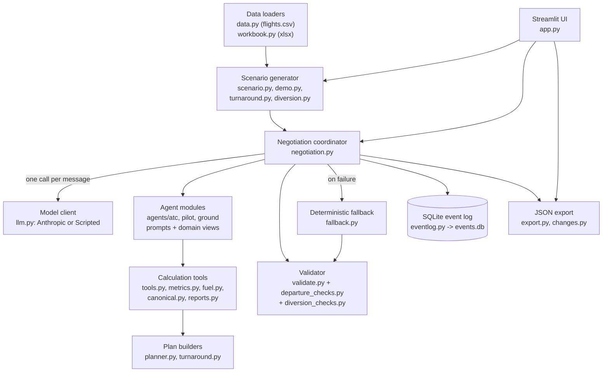
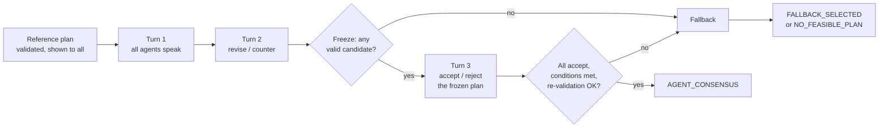

# Program Guide: Airport Disruption Negotiation Prototype

This guide explains how the program works, for someone who knows ordinary software but has not worked with AI agents. It was written from the source code, not only from the README. Where the two disagree, the code wins and the difference is noted in [section 13](#13-verification-and-limitations).

Three labels are used throughout:

- **Implemented** – exists in code and is exercised by tests or saved runs.
- **Simulated** – a number or condition the program invents (or a rule it assumes) because no real data was supplied.
- **Not implemented** – an idea or challenge objective that the code does not do.

---

## 1. The problem and the solution

### In plain English

A flight is late because of bad weather or a late incoming aircraft. When it finally arrives, three things must line up:

1. a **runway** must be free and safely spaced from other aircraft,
2. a **gate** must be free for the aircraft to park at,
3. the aircraft must still have enough **fuel** (airliners must land with a legal reserve).

Fixing one often breaks another. Moving a landing earlier may put two heavy aircraft too close together. Giving a plane a different gate may leave a ground crew double-booked. Waiting in the air to solve a gate problem burns fuel.

This program simulates that situation and lets three **software agents**, each speaking for one part of the airport, negotiate a plan. Ordinary code then checks the plan against hard rules. If the agents agree and the checks pass, the plan is accepted. If not, a simple, non-AI search picks a valid plan instead.

### Who is represented

| Agent role | Stands in for | Decides |
|---|---|---|
| **ATC** (air traffic control) | The control tower | Landing order, runway, taxi route |
| **Pilot** | One aircraft | Whether the landing time is acceptable for fuel and passengers |
| **Ground** | The airport's gates and ground crews | Which gate or remote stand, which crew, how long servicing takes |

The program produces a **recovery plan**: for each aircraft, its runway, landing (touchdown) time, taxi route, gate, gate-arrival time, ground crew and servicing times. Later scenarios also produce a turnaround and departure plan, or a diversion plan to another airport.

### What this is and is not

This is a **research prototype and simulation**. It is not connected to any real airport system and must not be used for real operational decisions.

- Real flight records (`flights.csv`) are used only to pick a disruption and supply a few facts (airports, route distance, delay minutes).
- Runway counts, gate counts and turnaround minimums come from a **synthetic** workbook that says "Not real airport data".
- Everything else (closures, fuel on board, crews, taxiways, weather) is invented by the scenario generator.
- Passing the program's checks means "consistent with the modelled rules", not "safe to fly" ([section 9](#9-constraints-precision-and-fallback)).

---

## 2. What an AI agent means here

### Terms first

- **LLM (large language model)**: a program that reads text and writes text. Claude is an LLM. On its own it only answers a prompt; it has no memory between calls and cannot do anything but produce text.
- **API**: a way for one program to call another over the network. Here the program sends text to Anthropic's API and receives text back.
- **Prompt**: the text sent to the LLM. This program sends a *system prompt* (standing instructions) and a *user prompt* (the current situation as JSON).
- **Agent**: an LLM wrapped in a repeating job. It has a role, receives specific information, may use tools, and must reply in a fixed format that other software reads and acts on.
- **Tool**: ordinary code the agent (or the coordinator on its behalf) can run to calculate something, such as "list valid plans and their consequences".
- **Schema**: a strict description of an allowed message shape. Replies that do not fit are rejected.

### LLM versus agent, with an airport example

Ask a bare LLM "Flight DL1205 is late, what should we do?" and you get an essay. An agent in this program is different:

1. It is told: *"You are the Pilot for DL1205. Protect fuel reserves. Reply with exactly one JSON message of type PROPOSE, COUNTER_PROPOSE, ACCEPT or REJECT."*
2. It is given data: DL1205's fuel, its earliest and latest safe landing times, the other agents' messages so far, and a menu of valid options that code has already computed.
3. It replies with a structured message, for example a counter-offer: *"Land DL1205 first at t+22.0 instead of t+25.6, because the connection for 30 passengers would be missed otherwise."*
4. Code (not the LLM) checks the reply's format, evaluates its conditions, validates the plan, and records everything.

So an agent is **instructions + domain data + tools + a structured reply**, repeated each turn. The LLM supplies judgment and wording; code supplies facts, arithmetic and rule enforcement.

### Why separate agents

Each role has different goals that genuinely conflict (ATC wants throughput, the Pilot wants this aircraft down soon with fuel intact, Ground wants to avoid overtime). Separate agents keep each viewpoint's information and goals distinct, and make disagreement and concessions visible in the log. The code gives each agent:

- its own system prompt ([ATC](airport_ops/agents/atc.py), [Pilot](airport_ops/agents/pilot.py), [Ground](airport_ops/agents/ground.py)),
- its own filtered "domain view" of the data (ATC sees separation rules and taxiways; Ground sees gates and crews; the Pilot sees its own fuel),
- its own separate model call for every message it sends.

### Do they use the same model?

Yes. In live mode every agent calls the same model, set by `NEGOTIATION_MODEL` (default `claude-opus-5-5`, see [`llm.py`](airport_ops/llm.py)). The agents differ only in the instructions, data and tools they are given.

### Why separate API keys do not make agents independent

The program lets you supply one key per role (`ANTHROPIC_API_KEY_ATC`, `_PILOT`, `_GROUND`). That changes **which account the call is billed to**, nothing else. Independence comes from separate prompts, separate data views and separate calls. Note also that agents are **not** isolated from each other's messages: all of them read the shared transcript ([section 3](#3-the-architecture)).

### Scripted mode versus live mode

- **Live mode**: real calls to Claude. Wording and choices vary run to run. Costs money; needs network and credentials.
- **Scripted mode**: [`ScriptedClient`](airport_ops/llm.py) runs fixed rules in [`agents/base.py`](airport_ops/agents/base.py) instead of a model. It uses the same message formats, coordinator and validator, so it exercises everything except real language-model behaviour. It is deterministic, free, and always labelled "SCRIPTED". It demonstrates the protocol; it does **not** show how a real model behaves.

A live run never silently falls back to scripted: missing credentials raise an error.

---

## 3. The architecture



### What uses AI and what does not

| Component | AI? | Role |
|---|---|---|
| Language-model calls in [`llm.py`](airport_ops/llm.py) (live mode only) | **Yes** | Produce each agent's proposal, counter-offer, accept or reject, plus an explanation |
| Everything else | No | Ordinary deterministic Python |

Specifically deterministic: loading data, building scenarios, enumerating valid candidate plans, computing metrics and fuel, evaluating conditions, validating plans, freezing the final candidate, the fallback search, logging and export.

### How messages actually flow

This is where the implementation differs from a casual reading of "ATC coordinates the plan":

- **The coordinator is the router, not ATC.** [`Coordinator`](airport_ops/negotiation.py) loops over the participants in a fixed order and makes one model call per message. Agents never call each other.
- **ATC is not a communication hub.** It is one participant. In the default five-agent arrival session the order is `PILOT@<each aircraft>` first, then `ATC@<airport>`, then `GROUND@<airport>` ([`sessions.py`](airport_ops/sessions.py)). In the legacy three-agent mode the order is ATC, Pilot, Ground.
- **Everything is broadcast.** Each agent's prompt includes the full message transcript so far, every registered proposal with its validation result and metrics, and the other agents' latest stated conditions ([`agents/base.py`](airport_ops/agents/base.py), `build_prompt`). There are no private messages.
- **Agents do not see each other's raw domain data.** They see only their own domain view plus the shared transcript. For example, only Ground's view lists crew shifts.

### Tools and "option menus"

Before each call the coordinator runs a deterministic tool that returns the top five valid plans ranked by *that agent's own* objective, with their consequences ([`tools.py`](airport_ops/tools.py), `option_menu`). The menu is advisory: the agent may propose any valid plan, and the code logs each tool call separately. The menus do not pick a winner; each role ranks differently, which is what produces disagreement.

### Export and replay

- **JSON export** is implemented ([`export.py`](airport_ops/export.py)), available as a download button in the UI.
- **Recorded replay is not implemented.** There is no feature to replay a saved live session. Only the deterministic scripted mode can reproduce a run, and only for the same code version.

---

## 4. Frameworks and dependencies

From [`requirements.txt`](requirements.txt), checked against actual imports:

| Package | Why it is needed here |
|---|---|
| **Streamlit** | The browser interface ([`app.py`](app.py)). Re-runs the script on every click, so the code stores finished sessions in `st.session_state` and de-duplicates log writes. |
| **Pydantic** | Defines and validates every data shape: scenarios, plans, messages ([`messages.py`](airport_ops/messages.py), [`schemas.py`](airport_ops/schemas.py), [`plan.py`](airport_ops/plan.py)). Malformed model replies fail here. |
| **pandas** | Loads and filters the 358,774-row flights CSV and joins airport names ([`data.py`](airport_ops/data.py)); also used for route distances and UI tables. |
| **openpyxl** | Reads the Excel workbook ([`workbook.py`](airport_ops/workbook.py)). |
| **anthropic** | The Claude SDK, imported only inside the live client ([`llm.py`](airport_ops/llm.py)). Scripted mode and tests never need network. |
| **sqlite3** (Python standard library) | The append-only event log ([`eventlog.py`](airport_ops/eventlog.py)). |
| **pytest** | Runs the tests in [`tests/`](tests/). **Not listed in `requirements.txt`**; install it separately (a small inconsistency). |

Optional tooling (headless browser screenshots) was used during development but is not part of the program.

---

## 5. Data and assumptions

### Input files (in [`data/`](data/))

- `flights.csv`: 2015 US flight records (358,774 rows). Already filtered to rows that meet `WEATHER_DELAY > 15 or LATE_AIRCRAFT_DELAY > 20`; the code applies that filter anyway.
- `challenge2_operational_constraints.xlsx`, four sheets:
  - `airport_capacity`: per airport, active runways, gates, runway movements per hour, minimum turnaround minutes, spare gates. Labelled synthetic.
  - `wake_separation`: minimum distance and time between aircraft by weight category.
  - `fuel_and_crew`: final reserve, contingency, holding burn, crew duty limits, gate-change notice.
  - `rules_of_play`: the challenge rules (including the three-turn limit).

There is no airline-name table, so the program shows the airline code (for example `DL`). Airport names come from the workbook's `airport_capacity` sheet.

### Choosing and passing a flight

In [`app.py`](app.py) the sidebar lists the filtered flights. The default is DL1205, PHX to ATL, 2015-01-01. The selected row becomes a `HistoricalFlight` ([`data.py`](airport_ops/data.py)) and is included in **every agent's prompt** as `historical_disruption_record`.

### Three data origins, kept separate

| Origin | Examples | Where |
|---|---|---|
| **Historical** (flights.csv) | Airline, flight number, tail number, airports, scheduled/actual times, delay minutes, route distance | `HistoricalFlight` in [`schemas.py`](airport_ops/schemas.py) |
| **Workbook** (synthetic limits) | Runway count, gate count, runway ops/hour, minimum turnaround, wake rules, fuel and duty rules | `WorkbookLimits` |
| **Simulated** (invented) | Runway closures, taxiway blockages, resident aircraft on gates, aircraft weight categories, fuel on board, crew shifts, connecting passengers, remote stand, waiting area, turnaround work content, alternate-airport weather, cruise speed | `SimulatedConditions`, `SimAssumptions` |

Model assumptions that the workbook does not provide live in `SimAssumptions` (for example 140 knots approach speed, 1.5 minutes runway occupancy, 450 knots cruise speed). The UI's "Simulated conditions" tab lists them.

### Why historical delay is not "holding time"

DL1205's record shows a 107-minute arrival delay. The program does **not** treat that as time the aircraft must still hold, nor as time the negotiation could "recover". The historical row only decides whether a weather closure or late crew is *simulated*. All negotiated times are simulated minutes from the scenario start (written `t+22.0`). Comparing them with the dataset's real clock times would be meaningless.

### Seeds, versions, reproducibility

- **Seed**: derived from the flight's date, label, origin and destination with a checksum ([`scenario.py`](airport_ops/scenario.py)), so the same flight always generates the same simulated conditions.
- **Scenario version**: a short content hash of the historical row, workbook limits and simulated data. Plans and messages carry it; a mismatch is rejected, and a changed scenario invalidates a session.
- **Caveat**: the version changes whenever the generator code changes. The saved evidence runs show version `af1df3e57f82`, but the same demo scenario built today has version `0013db3dac34` because later features (remote stand, waiting area) altered its content. So saved JSON cannot be reproduced bit-for-bit with current code.

### Units and missing data

- Time: minutes from scenario start (`t+N`), as decimals. Distances in nautical miles; fuel in kilograms; burn rates in kg per hour; durations in minutes (wake rules in seconds).
- Missing airport names become `None` (shown "Unknown"); airport identifiers stay strings; a flight to an airport missing from the workbook raises a clear `ScenarioError`; workbook problems are reported with sheet/row/column rather than crashing.

---

## 6. Agent responsibilities and decision authority

### How many agents

- **Default arrival and departure sessions**: five agents: one **Pilot per aircraft** (three aircraft: the selected historical flight plus two simulated ones), one ATC and one Ground for the airport.
- **Legacy mode** (sidebar option): three agents; one Pilot for the selected flight only. The two other aircraft are deterministic traffic with fixed constraints.
- **Diversion sessions**: five agents: the diverting aircraft's Pilot, ATC and Ground at the alternate, and ATC and Ground at the original destination. The alternate's two other flights are deterministic traffic.

Competing aircraft in the default mode are simulated flights (`SIM-A101`, `SIM-B202`) with seeded properties; each has a real Pilot agent in the five-agent mode.

### ATC ([`agents/atc.py`](airport_ops/agents/atc.py))

- **Sees**: aircraft weight categories and ETAs, runway closures, taxi network and blockages, separation rules, airport-wide and per-runway movement limits.
- **Soft preference**: minimise priority-weighted landing delay, avoid runway changes.
- **Hard constraints it must respect** (enforced by the validator, not by trust): runway availability, wake separation, runway occupancy, capacity, taxiway blockage.
- **Tools**: option menu ranked by weighted delay.

### Pilot ([`agents/pilot.py`](airport_ops/agents/pilot.py))

- **Sees**: only its own aircraft: fuel on board and margins, earliest and latest safe landing time, simulated position, simulated weather, crew duty clock, passenger connection preference.
- **Soft preference**: land near the nominal ETA, avoid holding, keep connections, keep a fuel cushion.
- **Hard constraints**: final fuel reserve and contingency fuel (never waived; only a computed `MINIMUM_FUEL` or `EMERGENCY` status relaxes them, see [section 9](#9-constraints-precision-and-fallback)); crew duty; gate compatibility.
- **First message**: includes a structured `report` (arrival window, fuel margin, maximum holding time). Code recomputes it and records any mismatch.
- **Tools**: option menu ranked by this aircraft's delay and connection.

### Ground ([`agents/ground.py`](airport_ops/agents/ground.py))

- **Sees**: gates, a simulated remote stand and safe waiting area, resident aircraft, ground crews, shift limits, turnaround minimums.
- **Soft preference**: avoid overtime, crew waiting and gate changes.
- **Hard constraints**: gate class and overlap, crew overlap and shift cap, minimum turnaround, gate-change notice.
- **Tools**: option menu ranked by overtime and waiting.

### Message types and limits on authority

All agents use the same four message types: `PROPOSE`, `COUNTER_PROPOSE`, `ACCEPT`, `REJECT` ([`messages.py`](airport_ops/messages.py)).

- An agent may propose **discrete choices** (landing order, runways, gates, crews). Code builds the complete timetable from them ([`planner.py`](airport_ops/planner.py)); the agent cannot invent times.
- An agent may attach **conditions** ("my delay stays at most X"). These are limited to a fixed list of fields and are checked by code.
- No agent can waive, edit or override a hard constraint. A plan that breaks one is flagged invalid regardless of who likes it.
- In turn 3 an agent can only accept or reject; it cannot change the plan.

### Other implemented functionality

- **Passenger connections** (simulated soft preference per flight), **weather** (simulated runway closures and taxiway blockages; the Pilot also sees the historical weather-delay minutes as context), **routing** (a small modelled taxi graph, so taxi-route changes are real), **turnaround and departure** ([`turnaround.py`](airport_ops/turnaround.py)), and **diversion** ([`diversion.py`](airport_ops/diversion.py)) exist. Details are in [section 13](#13-verification-and-limitations). **En-route flight-plan changes and turbulence are not modelled.**

---

## 7. A complete worked walkthrough

This follows the **conflict demonstration preset** on DL1205, using saved evidence. Two real saved runs are used. Both are the older **three-agent** protocol on the preset (before per-aircraft Pilots existed), and both used scenario version `af1df3e57f82`.

- **Scripted run**: [`demo_output/scripted_demo.json`](demo_output/scripted_demo.json), no language model.
- **Live run 2**: [`demo_output/live_run_2_postfix.json`](demo_output/live_run_2_postfix.json), real Claude calls (`claude-opus-5-5`), 62 seconds.

Live run 1 ([`live_demo.json`](demo_output/live_demo.json), [console log](demo_output/live_run_1_console.txt)) failed to reach consensus because of a rounding bug (since fixed) and is kept as evidence.

### Step 1: the disruption

Flight DL1205, Phoenix to Atlanta, 2015-01-01: scheduled arrival 11:27, actual 13:14, 107-minute delay (all weather). This is context only. The program simulates an arrival at Atlanta's workbook limits (4 runways, 150 gates, 45-minute minimum turnaround); only 2 runways and 3 gates are modelled.

### Step 2: the preset creates conflict

The preset ([`demo.py`](airport_ops/demo.py)) closes one runway, puts a priority-5 heavy aircraft (SIM-A101) on the field, gives DL1205 little spare fuel, and puts a resident aircraft on DL1205's gate. This is opt-in; ordinary sessions are not forced to disagree.

### Step 3: the initial reference plan

Before any agent speaks, the coordinator builds an **illustrative reference plan** ([`reference.py`](airport_ops/reference.py)): every aircraft lands at its nominal ETA on its original runway, gate and crew. DL1205 lands at t+22.0 and reaches GATE-1 at t+32.5.

The validator rejects it with six violated constraint types (wake separation, runway occupancy, gate overlap, crew overlap, taxi block, taxi conflict). It is **not** a feasible baseline and no improvement is claimed against it; it only shows what had to change.

### Step 4: opening proposal (message 1, ATC)

ATC proposes plan `prop-6385daa8ab`: all three aircraft use the single open runway, the heavy aircraft lands first, and DL1205 lands last at **t+25.64** (touchdown), reaching its gate at **t+55.0** (gate arrival, because the gate is occupied until t+50). Weighted delay 10.71, cost 57.4.

### Step 5: counter-offer and trade-off (message 2, Pilot)

The Pilot says the plan is fuel-safe but misses 30 connecting passengers' preferred gate time by 21 minutes. It counters with `prop-00e04bb086`: DL1205 lands first at t+22.0, with a new gate and taxi route. The coordinator measures the real effect: weighted delay **+4.71**, cost **+48.9**, two more gate changes.

### Step 6: validation of candidates

Every proposal is validated when registered. Both were valid (63 and 65 checks). The coordinator, not the agents, recorded those results and showed them to the next agent.

### Step 7: freezing and the outcome differ between the two runs

- **Live run 2**: the rest of turn 1 and turn 2 contested the counter. Ground and ATC argued it cost more; in turn 2 the Pilot **conceded**, accepting the 21-minute connection miss. The freeze rule selected ATC's original `prop-6385daa8ab`. All three agents accepted it in turn 3, all conditions resolved, and an independent re-validation passed (63 checks). Result: `AGENT_CONSENSUS`, 3 turns, 9 messages, 9 model calls, no repairs.
- **Scripted run**: the scripted policies settled on the Pilot's counter `prop-00e04bb086`. Result: `AGENT_CONSENSUS`, 3 turns, 9 messages (65 checks).

### Step 8: what actually changed for DL1205

| Item | Reference | Live run 2 (final) | Scripted (final) |
|---|---|---|---|
| Landing (touchdown) | t+22.0 | **t+25.64** | t+22.0 |
| Gate arrival (on-block) | t+32.5 | **t+55.0** | t+32.5 |
| Gate | GATE-1 | GATE-1 | **GATE-3** |
| Taxi route | via TWY-C | via TWY-C | **via TWY-D** |

Touchdown and gate arrival are different numbers and are reported separately. In live run 2 the arrival times got later (a delay against an infeasible reference), not better. In the scripted run only the gate and taxi route changed; touchdown and gate-arrival did not. The scenario version has changed since these were saved ([section 5](#5-data-and-assumptions)), so rerunning now gives different IDs and times.

### Step 9: exported evidence

The JSON export contains the scenario version, reference plan, all messages, every proposal version, the structured differences, votes, validation results, tool calls, model attempts and the outcome. It excludes credentials.

---

## 8. The three-turn protocol

### What a turn is

**One turn = one structured message from every participating agent.** With five agents a turn is five messages; with three, three. The order is fixed ([`sessions.py`](airport_ops/sessions.py), [`negotiation.py`](airport_ops/negotiation.py)), and each agent sees the earlier messages of the same turn.

### Maximum messages

Three turns, so at most `3 × number of agents`: **9** (three agents) or **15** (five agents). The data model has a hard ceiling of 21. The coordinator uses a fixed loop, and agents cannot request extra turns.

### Turn by turn

- **Turns 1 and 2**: any of the four message types. Agents propose, counter, accept or reject.
- **Between 2 and 3**: the coordinator **freezes** one candidate by a deterministic rule ([`FREEZE_RULE`](airport_ops/negotiation.py)): among plans that pass validation, rank by (1) number of agents whose stated conditions the plan meets, (2) fewest rejections, (3) most resolved acceptances, (4) lowest fixed-weight cost, (5) earliest version. If nothing valid exists, it goes straight to the fallback.
- **Turn 3**: agents may only `ACCEPT` or `REJECT` the frozen plan.

### Identity and versions

- **Proposal ID**: a hash of the plan's content, so identical plans share an ID and any change gives a new one. Plans are stored as immutable records with a digest.
- **Scenario version**: stamped on every message; mismatched plans or sessions are rejected.
- Accept and reject messages must name an exact proposal ID.

### Conditions

A condition is `field operator value`, for example "DL1205's landing delay ≤ 3.0". Only a fixed list of fields exists, and the coordinator evaluates conditions by code. An ACCEPT whose conditions are not all met is **unresolved** and does not count.

### What does not count toward consensus

- An acceptance of a plan other than the frozen one ("outdated").
- An acceptance with unresolved conditions.
- A rejection or missing message.

### Consensus rule

`AGENT_CONSENSUS` is recorded only if every agent's turn-3 message accepts the identical frozen plan with all conditions satisfied, **and** a fresh validation of the stored plan passes.

### Retries, timeouts and changes

- **Schema-repair retry**: if a reply is malformed, the same agent gets exactly **one** more attempt for the **same** message slot, with the error explained. It is logged as a separate "model attempt" and is not a negotiation message.
- **Timeouts**: each call has a timeout (default 90 s) and the whole session has a deadline (default 600 s). Either triggers the fallback.
- **Scenario change** mid-session: the session is marked `SESSION_INVALIDATED`; messages from different versions are never combined.

### Avoiding endless negotiation

A fixed loop, a three-turn cap, no plan changes in turn 3, one retry only, per-call and total deadlines, and a deterministic freeze rule. After three turns without agreement the fallback decides.



---

## 9. Constraints, precision and fallback

### Hard constraints versus preferences

- A **hard constraint** is a rule a plan must satisfy to be valid. Example: two aircraft landing on one runway must be at least the workbook's separation apart. Nobody can trade this away.
- A **preference** is something agents want but may concede. Example: keeping a connection, avoiding a gate change. Preferences appear as conditions, costs and objectives.

### Validation categories

[`validate.py`](airport_ops/validate.py) registers **49 constraint IDs** in `CONSTRAINTS`, each with a stated basis (the source of its rule). By basis: 14 cite workbook values, about 18 simulated conditions, 7 labelled assumptions, 5 computed, and the rest structural or input checks. Groups:

- Runway: availability, occupancy, wake separation, capacity (airport-wide from the workbook; per-runway share is a configurable assumption).
- Taxi: connectivity, timing, blockage, single-lane conflicts.
- Gates and stands: compatibility, overlap with buffer, change notice; safe waiting area and its capacity.
- Crews: flight-crew duty, ground-crew availability, overlap and shift cap.
- Time: minimum turnaround, task timing, sequencing.
- Fuel: final reserve, contingency, and fuel at gate after ground time.
- Departure-only ([`departure_checks.py`](airport_ops/departure_checks.py)) and diversion-only ([`diversion_checks.py`](airport_ops/diversion_checks.py)) checks.

Fuel arithmetic is documented in [`fuel.py`](airport_ops/fuel.py): trip fuel is burned once; holding burn uses the workbook rate; reserve and contingency must remain at landing.

### Why agents cannot waive constraints

Validation runs in code on the finished plan, independent of anything an agent says. A plan is accepted only through validation. Even a unanimous vote cannot make an invalid plan valid. Status relaxations (`MINIMUM_FUEL`, `EMERGENCY`) come from computed fuel numbers, not from the Pilot's claim.

### Canonical metrics and precision

Agents see numbers rounded in one consistent way, and their conditions are compared the same way ([`canonical.py`](airport_ops/canonical.py)): minutes, delays and costs at 2 decimals, change counts as integers, fuel margins at 6 decimals (effectively exact), identifiers exact.

This exists because a live agent once wrote "delay ≤ 10.71" about a plan whose exact value was 10.7143 and was wrongly marked unresolved.

**Display rounding must never weaken safety.** The validator and fuel code do not import the rounding module (a test enforces this) and use exact values with tiny tolerances. A deficit of 0.4 grams of fuel reserve, or a 10-millisecond wake-separation shortfall, is still rejected even though a rounded display would show zero.

### The fallback

If the agents fail to agree (or time out, or produce no valid plan), [`fallback.py`](airport_ops/fallback.py) runs a bounded search:

1. Enumerate a finite candidate set: every landing order × runway choice × gate choice × crew choice (24,576 combinations in the default arrival scenario; 768 in departure).
2. **Filter** by all hard constraints. A cheap plan that breaks a rule is discarded; safety is never traded against cost.
3. **Rank** survivors by fixed costs (delay × priority, gate/runway changes, remote stand, overtime, and so on).
4. Break ties by smaller worst-case delay, then by fixed enumeration order.
5. Validate the winner again before returning it.

**Timeout versus exhaustion**: `EXHAUSTED` means every candidate was examined; `TIMEOUT` means the search stopped early, which proves nothing about feasibility. "Exhausted" only covers this finite set (earliest landing slots, the modelled gates and crews), not every conceivable plan.

### Final statuses

| Status | Meaning |
|---|---|
| `AGENT_CONSENSUS` | All agents accepted the identical frozen plan; independent validation passed |
| `FALLBACK_SELECTED` | Agents did not agree; the non-AI search chose a valid plan. **Never** described as consensus |
| `NO_FEASIBLE_PLAN` | No valid plan found; the case must be escalated to a human |
| `SESSION_INVALIDATED` | The scenario changed mid-session |

### Limits of "valid"

Passing these checks means the plan is consistent with the program's simplified, partly invented rules. It does **not** establish real-world aviation safety.

---

## 10. Logs, security and reproducibility

### What is logged

[`eventlog.py`](airport_ops/eventlog.py) writes an append-only SQLite table (`events.db` in the project root). Event types recorded by the coordinator include: `negotiation_started`, `reference_plan`, `model_attempt`, `tool_call`, `agent_message`, `decision_record`, `proposal_registered`, `validation_performed`, `candidate_frozen`, `AGENT_CONSENSUS`, `fallback_invoked`, `negotiation_finished`.

Model attempts (including repair retries), tool calls and validations are separate rows from messages.

### Session IDs and rerun de-duplication

Each negotiation has a unique session ID (`neg-` plus random hex). Streamlit re-runs the script on every interaction, so each event has a unique `dedupe_key`; writing the same event again is ignored. Finished sessions are kept in `st.session_state`, so a rerun does not repeat model calls. A deliberate new run gets a new ID.

### JSON export

The download in the "Requirement demo" tab contains the full session ([`export.py`](airport_ops/export.py)): scenario version, reference plan, messages, proposal versions, structured changes, votes, validation results, tool calls, model attempts, outcome. All text passes through a redaction step ([`llm.sanitize`](airport_ops/llm.py)) that removes known key values, `sk-ant-…` patterns and authorization headers.

### Credentials

Keys come only from environment variables or a local `.env` file ([`.env.example`](.env.example) shows the names with empty values):

- `ANTHROPIC_API_KEY_ATC`, `ANTHROPIC_API_KEY_PILOT`, `ANTHROPIC_API_KEY_GROUND` (all three, one per role), **or** a single `ANTHROPIC_API_KEY`.
- Optional: `NEGOTIATION_MODEL`, `NEGOTIATION_CALL_TIMEOUT_S`, `NEGOTIATION_DEADLINE_S`, `NEGOTIATION_EFFORT`, `NEGOTIATION_MODE`.

Partly-set per-agent keys are refused rather than mixed. Variables already set in the shell override the file. The app shows which names were read, never values.

### What belongs in Git

| Commit | Keep local |
|---|---|
| Source code, tests, `README.md`, this guide, `requirements.txt`, `.env.example`, `.gitignore`, saved evidence JSON/console files in `demo_output/` | `.env`, `events.db` and all `*.db` files, `__pycache__/`, `.pytest_cache/`, `.DS_Store` |

The [`.gitignore`](.gitignore) already excludes the local items. The repository also currently tracks `data/flights.csv` (about 38 MB); consider Git LFS or ignoring it.

### Reproducibility

Same flight, same code version: identical scenario and (in scripted mode) identical results. Live runs are not reproducible; the model's wording and choices vary. There is no recorded-replay feature.

---

## 11. Project structure

**Where to begin:** run [`app.py`](app.py); read [`negotiation.py`](airport_ops/negotiation.py) for the core protocol, then [`validate.py`](airport_ops/validate.py).

```text
app.py                      Streamlit interface (entry point)
requirements.txt, .env.example, README.md, PROGRAM_GUIDE.md
data/                       flights.csv and the operational workbook
demo_output/                saved evidence from earlier runs
tests/                      automated tests
airport_ops/
  data.py                   flights.csv loader and airport-name join
  workbook.py               reads and validates the Excel workbook
  schemas.py                historical / workbook / simulated data models
  scenario.py               seeded scenario generator, scenario version
  demo.py                   optional conflict preset
  reference.py              illustrative initial reference plan
  plan.py                   plan and resource-occupancy models
  planner.py                builds a full timetable from discrete choices
  validate.py               hard-constraint validator (+ departure_checks.py, diversion_checks.py)
  fuel.py, capacity.py      documented fuel arithmetic; runway-limit rules
  fallback.py               deterministic bounded fallback search
  messages.py               message schemas, conditions, participants
  negotiation.py            the coordinator (turns, freeze, consensus)
  negotiation_types.py      result and record models
  sessions.py               which agents take part in a session
  agents/                   atc.py, pilot.py, ground.py, base.py (prompts, views, scripted policy)
  llm.py                    live Claude client, scripted client, credentials, redaction
  tools.py, metrics.py      candidate pool, option menus, metrics, condition checks
  canonical.py              agent-visible number precision
  reports.py                Pilot report / readiness verification
  turnaround.py             scenario 4: turnaround and departure
  diversion.py              scenario 3: diversion and emergency
  changes.py, export.py     structured differences; JSON export
  eventlog.py, report.py    SQLite event log; display rows
```

Links: [`data.py`](airport_ops/data.py), [`workbook.py`](airport_ops/workbook.py), [`schemas.py`](airport_ops/schemas.py), [`scenario.py`](airport_ops/scenario.py), [`demo.py`](airport_ops/demo.py), [`reference.py`](airport_ops/reference.py), [`plan.py`](airport_ops/plan.py), [`planner.py`](airport_ops/planner.py), [`fuel.py`](airport_ops/fuel.py), [`capacity.py`](airport_ops/capacity.py), [`messages.py`](airport_ops/messages.py), [`negotiation_types.py`](airport_ops/negotiation_types.py), [`agents/base.py`](airport_ops/agents/base.py), [`metrics.py`](airport_ops/metrics.py), [`canonical.py`](airport_ops/canonical.py), [`reports.py`](airport_ops/reports.py), [`changes.py`](airport_ops/changes.py), [`report.py`](airport_ops/report.py).

---

## 12. Setup and usage

### Install

```bash
pip install -r requirements.txt
pip install pytest          # not in requirements.txt
```

### Configure (live mode only)

Copy `.env.example` to `.env` and fill in placeholders yourself; never commit it.

```bash
cp .env.example .env
# ANTHROPIC_API_KEY_ATC=<your key>   (and _PILOT, _GROUND), or ANTHROPIC_API_KEY=<your key>
```

### Start the app

```bash
python3 -m streamlit run app.py
```

### Run a session

1. Sidebar: pick a flight (default DL1205), a **Scenario** kind (landing, turnaround and departure, or diversion), and optionally tick **Conflict demonstration preset**.
2. **Scripted** (free, offline): tab **Requirement demo**, click **Run demonstration**.
3. **Live**: tab **Negotiation (agents)**, choose **Live LLM**; the banner shows which credentials were found. Return to **Requirement demo** and click **Run demonstration**, or click **Start new negotiation**.
4. Download the session JSON at the bottom of **Requirement demo**.

### Run tests

```bash
python3 -m pytest -q
```

The suite collects 163 tests. It needs no keys, makes no network calls, and never reads your real `.env`. It takes several minutes.

### Network, runtime and cost

Live mode needs internet access and valid credentials. A five-agent session makes at least 15 model calls (plus any repair retries); the saved three-agent live run took 62 seconds for 9 calls. Runtime varies run to run. Cost depends on your account's pricing and the number of tokens; no price is stated here, and the saved runs recorded token counts (around 9,000 to 15,000 input tokens per call) rather than cost.

---

## 13. Verification and limitations

### What has been verified, by method

| Method | What it covers | Evidence |
|---|---|---|
| **Automated tests** | Workbook loading, validator rules, fuel and precision boundaries, fallback, the UI re-run behaviour, all four scenario kinds | 163 collected tests in [`tests/`](tests/); the last full run before this guide passed all 163 |
| **Mocked-model tests** | Coordinator behaviour with controlled replies: success, malformed replies and repair, timeout, outdated and unresolved acceptances, version mismatch, infeasible scenario, fallback labelling | [`tests/test_negotiation.py`](tests/test_negotiation.py), [`tests/mocks.py`](tests/mocks.py) |
| **Scripted demonstrations** | The whole pipeline with deterministic policies | [`demo_output/scripted_demo.json`](demo_output/scripted_demo.json); scripted sessions also run in the tests for landing, departure and diversion |
| **Live verification** | Real Claude calls | Two live runs, both **three-agent, conflict preset** ([section 7](#7-a-complete-worked-walkthrough)): run 1 fell back because of a (fixed) rounding defect; run 2 reached consensus. One successful session is not a reliability estimate |

### Not yet verified live

The **five-agent protocol** (per-aircraft Pilots, Pilot readiness report, declared status, destination agents) and the **turnaround/departure** and **diversion** scenarios have only been run in scripted, mocked and UI tests. No live run exists for them, so prompt compliance and real-model behaviour there are unknown. This guide did not make paid calls.

### Inconsistencies found while writing this guide

- `README.md` and some code comments still refer to "three agents" in places; the default is now five.
- Saved evidence uses scenario version `af1df3e57f82`; current code builds a different version for the same scenario, so the saved runs cannot be exactly reproduced today.
- `pytest` is not in `requirements.txt`.
- The README suggests hygiene checks were on a throwaway copy; the project folder is in fact a Git repository, with `data/flights.csv` tracked.
- The task brief mentioned recorded replay; the code has none (only JSON export), so none is described as available.

### Limitations

- Everything beyond the workbook's capacity rows and the dataset's flight records is simulated; the workbook itself is labelled synthetic.
- No turbulence, real weather, en-route flight-plan changes or real position data. Position and weather are simulated.
- Diversion considers one alternate per session; the alternate's other flights have no Pilot agents.
- The reference plan is invalid by design, so **no efficiency improvement has been established**. A claim of improvement would need a comparison with a feasible baseline (for example the fallback plan), which has not been done.
- Candidate search is a finite set; "no feasible plan" means none within it.
- Agents mostly choose among option-menu plans; much of the conflict comes from the preset's differing objectives.
- Not implemented: recorded replay, more than one alternate airport, aircraft-to-route assignment (out of scope), and any real operational integration.

### Unimplemented challenge objectives

Recorded replay of live sessions; live verification of scenarios 3 and 4 and of the five-agent mode; efficiency claims against a feasible baseline.

---

## 14. Glossary

- **Agent**: an LLM given a role, data, tools and a required reply format, called repeatedly.
- **API**: an interface for one program to call another over a network.
- **Constraint**: a rule a plan must satisfy. *Hard* constraints cannot be waived.
- **Consensus**: all agents accept the identical plan and validation passes (`AGENT_CONSENSUS`).
- **Coordinator**: the code that runs the turns, calls the model for each agent and records results.
- **Counter-offer**: a message proposing a different plan in response to an earlier proposal.
- **Deterministic**: always gives the same output for the same input; no randomness or model judgment.
- **Event log**: the SQLite table recording what happened.
- **Fallback**: the non-AI search that chooses a valid plan when agents do not agree.
- **Gate arrival (on-block)**: when the aircraft reaches its gate; later than touchdown.
- **LLM**: a model that reads and writes text.
- **Preference**: a soft goal agents may concede.
- **Prompt**: the text sent to the model.
- **Proposal**: a complete plan put forward by an agent, identified by a content-hash ID.
- **Reference plan**: the illustrative starting plan, normally invalid.
- **Schema**: a strict definition of an allowed data shape.
- **Scenario version**: a content hash identifying exactly which scenario a plan belongs to.
- **Scripted mode**: deterministic stand-in policies instead of a language model.
- **Seed**: a number that fixes the pseudo-random choices, so the same flight yields the same scenario.
- **Token**: a chunk of text (roughly a short word fragment) that models read and are billed by.
- **Touchdown (landing) time**: when the wheels meet the runway.
- **Validator**: the code that checks a plan against all hard constraints.
